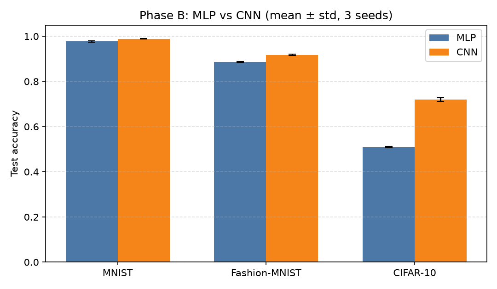
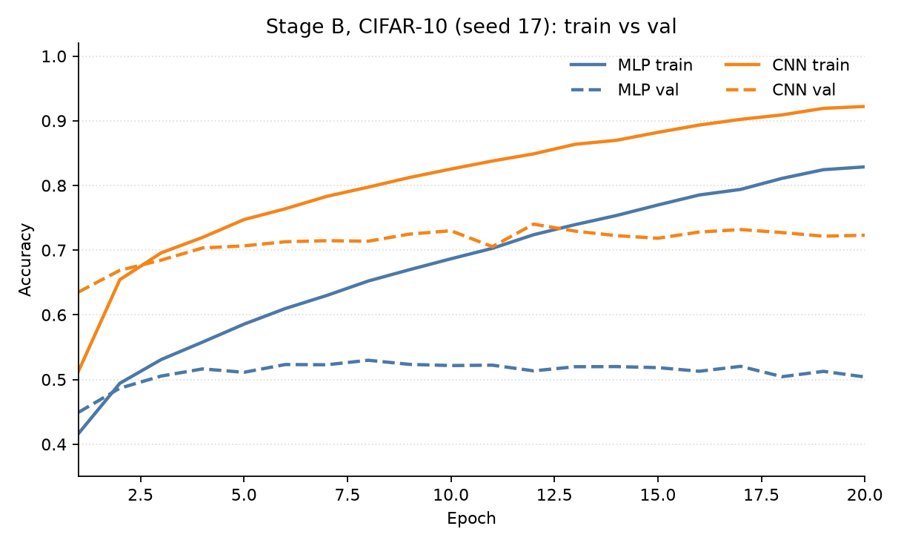
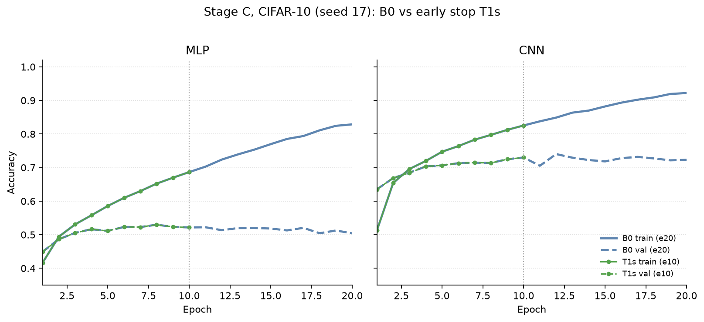
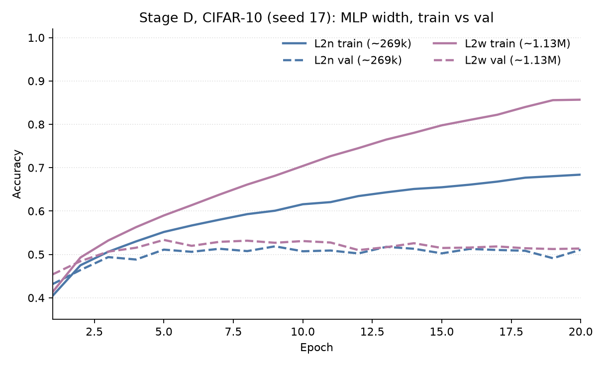

# MLP 与 CNN 图像分类对照实验

在统一预处理、交叉熵损失与训练协议下，比较多层感知机（MLP）与卷积神经网络（CNN）在 MNIST、Fashion-MNIST、CIFAR-10 上的测试性能，并观察任务变难时二者差距的变化。

完整协议见 [docs/experiment_design.md](docs/experiment_design.md)。成文报告（结果、结论、以及用后续实验排除替代解释）见 [docs/report.md](docs/report.md)。

| 阶段 | 内容 | 文档 |
|------|------|------|
| A 预实验（必做） | 仅 MNIST 上定结构与超参；`-mode train`，不跑测试集 | [pre_A1](docs/results/pre_A1.md) · [pre_A2](docs/results/pre_A2.md) · [pre_A3](docs/results/pre_A3.md) |
| B 主对比（必做） | 三数据集 × 两模型 × 三种子，共 18 次 | [exp1](docs/results/exp1.md) |
| C 超参敏感性（可选） | CIFAR-10，4 组超参，24 次 | [exp2](docs/results/exp2.md) |
| D 宽度敏感性（可选） | CIFAR-10，三组两层、组内参数量对齐，18 次 | [exp3](docs/results/exp3.md) |

## 环境

- Python 3.10+，PyTorch，torchvision
- 本机实验环境：`image-cls`，PyTorch 2.5.1+cu121，GPU RTX 4060 Laptop

```bash
conda create -n image-cls python=3.11
conda activate image-cls

# GPU（按本机 CUDA 选择，见 https://pytorch.org）
pip install torch torchvision --index-url https://download.pytorch.org/whl/cu121
```

数据首次运行自动下载到 `data/<dataset>/`。

## 冻结配置（阶段 A 后不再改）

预实验只在 MNIST 上、只用验证集选参；超参由 MLP 选定（A2 入选 T2），再用 CNN 验证一次（A3 通过）。正式对比不得回写下表。

| 项目 | 取值 |
|------|------|
| MLP 结构 | `-d 256 128` |
| CNN 结构 | `-d 32 64` |
| 优化器 / 学习率 | Adam，`0.001` |
| 轮次 | MNIST / Fashion-MNIST：`10`；CIFAR-10：`20` |
| 批大小 / 损失 | `128` / 交叉熵 |
| 验证集 | `-vr 0.1`（从官方训练集划出） |
| 正式实验种子 | `17`，`32`，`61` |

预处理：`ToTensor` + 各数据集预设均值方差的 `Normalize`。无数据增强。

## 复现：阶段 B 主对比

对每个数据集、每个种子各跑 MLP 与 CNN（共 18 次）。CIFAR-10 用 `-e 20`，其余 `-e 10`。

```bash
python main.py -mode train_test \
  -m mlp -ds <mnist|fashion_mnist|cifar10> -d 256 128 \
  -opt adam -lr 0.001 -e <10|20> -s <17|32|61> -vr 0.1 \
  -mn exp1_<dataset>_mlp_d256-128_s<seed>

python main.py -mode train_test \
  -m cnn -ds <mnist|fashion_mnist|cifar10> -d 32 64 \
  -opt adam -lr 0.001 -e <10|20> -s <17|32|61> -vr 0.1 \
  -mn exp1_<dataset>_cnn_d32-64_s<seed>
```

阶段 C / D 的命令与分组见设计书第 8、9 节。查看全部参数：`python main.py -h`。

## 主结果（阶段 B）

官方测试集准确率，三个种子的 mean ± sample std：

| 数据集 | MLP | CNN | 差值 (CNN−MLP) |
|--------|-----|-----|----------------|
| MNIST | 0.9770 ± 0.0034 | 0.9890 ± 0.0011 | 0.0120 |
| Fashion-MNIST | 0.8861 ± 0.0016 | 0.9178 ± 0.0025 | 0.0317 |
| CIFAR-10 | 0.5090 ± 0.0029 | 0.7201 ± 0.0077 | 0.2110 |



- 三个数据集上 CNN 均高于 MLP；多种子波动较小。
- 任务变难时两模型都下降，**差值扩大**（约 1.2 → 3.2 → 21.1 个百分点）。
- CIFAR-10 绝对准确率偏低，符合浅网络、无增强、超参由 MNIST 选定的设定；该数据集上 train 明显高于 val/test（过拟合），不回改冻结配置。



## 敏感性（阶段 C / D，均在 CIFAR-10）

定性结论「仍成立」= CNN 测试准确率均值仍明显高于 MLP。

**C：换超参，结构不变。** 早停、更小/更大学习率、SGD 四组差值约 0.20～0.25，均与阶段 B 同向。B0（20 轮）与 T1s（10 轮）曲线见下图；明细：[exp2.md](docs/results/exp2.md)。



**D：固定两层，组内对齐参数量后加宽。**

| 组 | CNN / MLP `-d` | N（约） | MLP | CNN | 差值 |
|----|----------------|---------|-----|-----|------|
| L2n | `16 32` / `86 46` | 269k | 0.5048 ± 0.0034 | 0.6975 ± 0.0052 | 0.1928 |
| L2m | `32 64` / `172 88` | 545k | 0.5050 ± 0.0130 | 0.7201 ± 0.0077 | 0.2150 |
| L2w | `64 128` / `344 192` | 1.13M | 0.5164 ± 0.0039 | 0.7406 ± 0.0035 | 0.2242 |

加宽后 CNN 从约 0.70 升到 0.74，MLP 仍约 0.50～0.52（训练准确率升高、验证几乎不动，见下图）。阶段 B 上 MLP 参数更多（约 821k vs 545k）并不是它落后的原因。明细：[exp3.md](docs/results/exp3.md)。



C / D 结果不回写第 6 节冻结配置。

## 目录结构

```
.
├── main.py                 # 入口
├── train.py / test.py
├── dataset_config.py
├── models/mlp.py, cnn.py
├── docs/experiment_design.md
├── docs/results/           # 各阶段记录与对比图
├── data/                   # 数据集（gitignore）
├── logs/                   # 每次运行的 history.csv / config.json / metrics.json（gitignore）
└── checkpoints/            # 权重（gitignore）
```

`logs/` 与 `checkpoints/` 默认不入库。复现数字需在本地按上一节命令重跑，或自行保留这些目录。

## 命令行参数

| 参数 | 短选项 | 默认 | 说明 |
|------|--------|------|------|
| `--mode` | `-mode` | `train` | `train` / `test` / `train_test` |
| `--model` | `-m` | `mlp` | `mlp` / `cnn` |
| `--dataset` | `-ds` | `mnist` | `mnist` / `fashion_mnist` / `cifar10` |
| `--dims` | `-d` | `256 256` | MLP 隐藏层宽度；CNN 各卷积层通道数 |
| `--optimizer` | `-opt` | `adam` | `adam` / `sgd` |
| `--lr` | `-lr` | `0.001` | 学习率 |
| `--epochs` | `-e` | `10` | 训练轮数 |
| `--seed` | `-s` | `42` | 随机种子（同时用于 train/val 划分） |
| `--val_ratio` | `-vr` | `0.1` | 从官方训练集划出验证集的比例 |
| `--model_name` | `-mn` | `model_0` | 本次运行名称（决定日志与权重路径） |

- MLP 的 `-d` 为各隐藏层神经元数（如 `256 128`）；CNN 为各卷积层通道数（如 `32 64`）。CNN 每层后有一次 `MaxPool2d(2)`。
- `-mn` 只用于区分保存路径，与 `-m` 无关；同名会覆盖旧权重。
- `-mode test` 时只需 `-mn`，结构从 checkpoint 恢复。

## 许可证

本项目仅供学习使用。
