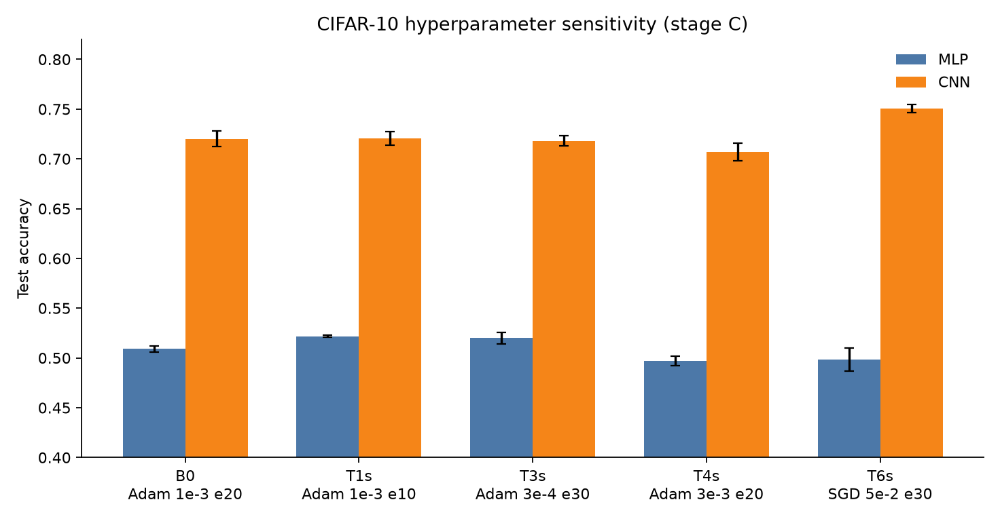
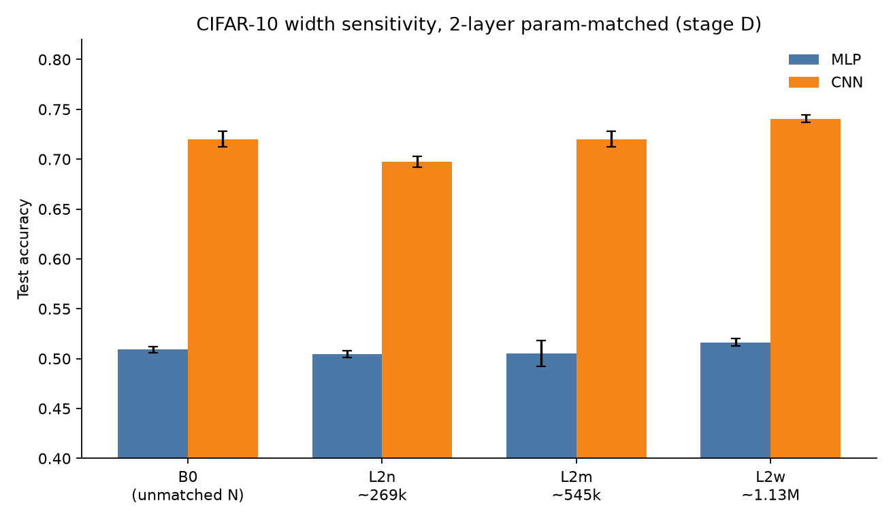

# MLP 与 CNN 图像分类对照实验报告

| 项目 | 内容 |
|------|------|
| 实验性质 | 对照实验 |
| 代码 | 本仓库 `main.py` |
| 协议 | [experiment_design.md](experiment_design.md) |
| 环境 | `image-cls`；PyTorch 2.5.1+cu121；GPU RTX 4060 Laptop |
| 日期 | 2026-08-30（A/B）～ 2026-09-03（C/D） |


---

## 1. 问题与总体逻辑

要比较的是：在相同数据预处理、交叉熵损失和训练协议下，MLP 与 CNN 的测试分类准确率，以及任务变难时二者差距如何变化。数据集按视觉难度递增：MNIST（1×28×28）→ Fashion-MNIST（1×28×28）→ CIFAR-10（3×32×32）。

由于结构、超参、容量、训练轮次都会和「模型类型」在一起共同影响模型准确率，为尽可能排除干扰，实验流程设计为：

```text
A 在 MNIST 上通过预实验确定结构与协议
        ↓ 冻结配置
B 在三组数据集上进行对比，得到主要结论
        ↓ 主结论在 CIFAR-10 上差距最大，但还可能被超参/过拟合解释
C 在 CIFAR-10 上更换超参再次对比，排除超参影响
        ↓ 仍可能是参数量不同
D 固定两层、组内对齐参数量后再加宽，排除「MLP 参数更多/更少」
```

评价约定：预实验只用验证集、不跑测试集；正式对比用官方测试集、三个种子的 mean±std。

---

## 2. 预实验 A：定「训什么、怎么训」

**目的。** 选定默认宽度和共用训练协议，使训练稳定、可复现。本阶段**不是** MLP vs CNN 的比分实验：超参只在 MLP 上选，再用 CNN 验证一次能否正常训练。

**材料。** 仅 MNIST；`val_ratio=0.1`；种子 42；`-mode train`。

### 2.1 A1 结构

临时固定 Adam、`lr=0.001`、10 epoch，各扫三档宽度。选参：达标（最终 val_acc ≥ 0.90）后取中等宽度。

| 模型 | 候选 | 最终 val_acc | 入选 |
|------|------|--------------|------|
| MLP | `128 64` / `256 128` / `512 256` | 0.9742 / **0.9792** / 0.9765 | `256 128` |
| CNN | `16 32` / `32 64` / `64 128` | 0.9878 / **0.9905** / 0.9877 | `32 64` |

三档均达标；中等档同时最高，故入选。

### 2.2 A2 超参（仅 MLP）

结构固定为 `256 128`，比较 T1–T6。六组全部达标。按「更简优先、其次 Adam 0.001」入选 **T2**：Adam，`lr=0.001`，10 epoch。CIFAR-10 轮次取 2 倍，为 20。

### 2.3 A3 CNN 接通

用同一协议跑 CNN `32 64` 一次：最终 val_acc = 0.9905，训练稳定，通过。第 6 节正式冻结。

---

## 3. 主对比 B：任务变难时差距是否扩大

**目的。** 在冻结配置下，变化因素只有「数据集 × 模型类型」，每种组合三种子，共 18 次，`-mode train_test`。

### 3.1 实验结果

测试准确率 mean±std：

| 数据集 | MLP | CNN | 差值 (CNN−MLP) |
|--------|-----|-----|----------------|
| MNIST | 0.9770 ± 0.0034 | 0.9890 ± 0.0011 | 0.0120 |
| Fashion-MNIST | 0.8861 ± 0.0016 | 0.9178 ± 0.0025 | 0.0317 |
| CIFAR-10 | 0.5090 ± 0.0029 | 0.7201 ± 0.0077 | 0.2110 |


CIFAR-10 上训练过程（种子 17；实线训练集，虚线验证集）：


CIFAR-10 上 MLP 最终 train_acc 约 0.83、test 约 0.51；CNN train 约 0.92～0.95、test 约 0.72。验证准确率大约在第 5～12 轮达到平台，之后训练集继续上升。

### 3.2 实验结论

1. 三个数据集上 CNN 测试准确率均高于 MLP，多种子波动小。
2. 任务变难时两模型都下降，**差值扩大**（约 1.2 → 3.2 → 21.1 个百分点）。主对比的核心现象出现在 CIFAR-10。
3. CIFAR-10 绝对准确率不高，符合浅网络、无数据增强的模型表现。
4. CIFAR-10 存在明显过拟合（train ≫ val/test）。

### 3.3 实验不足

主结论「难数据上 CNN 明显更好」此时**还不能单独归因于卷积结构**，至少还有这些替代解释：

| 残留因素 | 为什么构成威胁 |
|----------|----------------|
| 训练超参 | 协议在 MNIST 上用 MLP 选定；CIFAR 的 20 轮可能对某一模型更不公平（过拟合、学习率、优化器） |
| 过拟合 / 轮次 | 曲线显示 val 中途见顶；差距会不会只是「MLP 过拟合更狠」？ |
| 宽度档位 | 只测了 A1 的中等宽度，结论会不会只在这一档成立？ |

因此在 CIFAR-10 上做实验 C（动超参、结构不变）和实验 D（动宽度并对齐参数量、协议不变）。

---

## 4. 实验 C：排除「只是这一组超参」

**目的。** 结构仍为 MLP `256 128`、CNN `32 64`。在 CIFAR-10 上换有限组超参，看「CNN 明显高于 MLP」是否还成立。

| tag | 设置 | 相对 B0 |
|-----|------|---------|
| T1s | Adam 0.001，10 epoch | 只减轮次（早停） |
| T3s | Adam 0.0003，30 epoch | 更小 lr + 更长训 |
| T4s | Adam 0.003，20 epoch | 只加大 lr |
| T6s | SGD 0.05，30 epoch | 换优化器（实现无 momentum） |

### 4.1 实验结果

| 组 | MLP | CNN | 差值 | 与 B 定性一致 |
|----|-----|-----|------|----------------|
| T1s | 0.5217 ± 0.0010 | 0.7208 ± 0.0067 | 0.1991 | 是 |
| T3s | 0.5200 ± 0.0057 | 0.7181 ± 0.0049 | 0.1981 | 是 |
| T4s | 0.4970 ± 0.0050 | 0.7070 ± 0.0086 | 0.2100 | 是 |
| T6s | 0.4984 ± 0.0119 | 0.7507 ± 0.0042 | 0.2523 | 是 |
| B0（引用） | 0.5090 ± 0.0029 | 0.7201 ± 0.0077 | 0.2110 | — |

最终 epoch 的 train−val 差距：T1s 明显小于 B0（MLP 0.16 vs 0.32；CNN 0.12 vs 0.22）；T3s / T6s 更大。



B0 与早停 T1s 的训练 / 验证曲线（种子 17；竖线为第 10 轮）：


### 4.2 实验结论

四组差值约 19.8～25.2 个百分点，符号与幅度都与 B 一致，远大于多种子波动。

- **早停（T1s）** 减轻了过拟合，MLP 测试还略升（0.522 vs 0.509），但差距仍约 20 个百分点。因此 B 的差距**不是**过拟合造成的。
- **更小 lr 更长训（T3s）** 测试接近 B0，过拟合更重，差距方向不变。
- **更大 lr（T4s）** 两模型都略降，差值几乎仍是 0.210。
- **SGD（T6s）** CNN 升到 0.751，差距扩大到 0.252。结论在换优化器后仍成立，且没有缩小。

**阶段 C 排除了：**「主结论只在 Adam、lr=0.001、20 epoch 这一组超参下成立」；以及「CIFAR 上的差距主要来自 20 轮过拟合」。

**做完 C 仍未排除的因素。** 结构一直是默认宽度，两模型参数量仍不对齐（MLP 更大）。CNN 的优势可能来自「碰巧更合适的容量」。

---

## 5. 实验 D：排除「参数量不同」

**目的。** 协议回到第 6.2 节。只改变两层网络的宽度，并在每一组内让 MLP 与 CNN 总参数量相对误差 < 0.2%。固定两层，是因为本实现中 CNN 每多一个通道层就多一次 2×2 池化，分类头随特征图变小，参数量可能不增反减。

先定 CNN 通道（A1 的三档加倍），再匹配漏斗形两层 MLP：

| 组 | CNN `-d` | N_cnn | MLP `-d` | N_mlp |
|----|----------|-------|----------|-------|
| L2n | `16 32` | 268,746 | `86 46` | 268,750 |
| L2m | `32 64` | 545,290 | `172 88` | 544,670 |
| L2w | `64 128` | 1,126,026 | `344 192` | 1,125,282 |

L2m 的 CNN 与阶段 B 相同，便于看「同一 CNN、MLP 从 821k 收到 545k」之后差距是否还在。

### 5.1 实验结果

| 组 | MLP | CNN | 差值 | 与 B 定性一致 |
|----|-----|-----|------|----------------|
| L2n（~269k） | 0.5048 ± 0.0034 | 0.6975 ± 0.0052 | 0.1928 | 是 |
| L2m（~545k） | 0.5050 ± 0.0130 | 0.7201 ± 0.0077 | 0.2150 | 是 |
| L2w（~1.13M） | 0.5164 ± 0.0039 | 0.7406 ± 0.0035 | 0.2242 | 是 |
| B0（未对齐：MLP 821k / CNN 545k） | 0.5090 ± 0.0029 | 0.7201 ± 0.0077 | 0.2110 | — |

L2m 的 CNN 三次测试准确率与阶段 B 逐条一致。



MLP 窄档与宽档的训练 / 验证曲线（种子 17）：


加宽后 MLP 的 train_acc 从约 0.69 升到约 0.86，val 仍停在约 0.51；测试损失从 1.58 升到 2.33。新增容量主要用在拟合训练集。

### 5.2 实验结论

1. 对齐参数量之后，三档宽度上 CNN 仍明显高于 MLP，差值 19.3～22.4 个百分点。
2. **容量差不是主因。** B 里 MLP 参数更多也输；D 里收到与 CNN 相同的 545k（L2m）后仍约 0.505，差值 0.215，与 B0 的 0.211 几乎相同。
3. 加宽对 CNN 更有用（0.698 → 0.720 → 0.741），MLP 几乎停在 0.50～0.52，差距略扩大，没有追上。

**阶段 D 排除了：** CNN 更好是因为参数更多或恰好碰到合适的结构

---

## 6. 总结论

在统一预处理与冻结训练协议下：

1. **主结论（B）。** CNN 在三个数据集上测试准确率均高于 MLP；随 MNIST → Fashion-MNIST → CIFAR-10，差值从约 1 个百分点扩大到约 21 个百分点。
2. **不是某一组超参（C）。** 早停、更小/更大学习率、SGD 下，CIFAR-10 上差值仍约 20～25 个百分点。早停减轻过拟合，但不消除差距。
3. **不是参数量（D）。** 两层、组内对齐容量并加宽后，MLP 仍约 50%，CNN 约 70%～74%。B 中 MLP 参数更多，也解释不了它落后。

因此，在本项目的浅网络、无增强设定下，CIFAR-10 上的差距应主要归因于 **CNN 的空间归纳偏置**（局部连接、权值共享、池化），而不是选参偶然、训得太久，或两边容量没对齐。

明细与复现命令：[README](../README.md)；设计书第 6～9 节；[pre_A1](results/pre_A1.md) / [pre_A2](results/pre_A2.md) / [pre_A3](results/pre_A3.md) / [exp1](results/exp1.md) / [exp2](results/exp2.md) / [exp3](results/exp3.md)。
